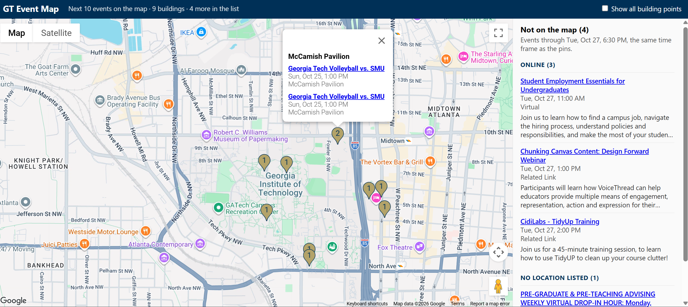

## GT Event Map: Finding Events on Georgia Tech's Campus

A map of what's happening on Georgia Tech's campus, built from the official GT campus calendar feeds.

<!-- Add a live demo link here once the app is deployed, e.g.
**[Live demo](https://your-app.vercel.app)** -->



### Why I'm building this

When I was a Tech student, I missed out on many events because there were too many places to look for them, and I couldn't see the events on a map or filter them by what I cared about. This app pulls event information into one place and shows it on a map of campus, so students can find events more easily and be more involved in campus life.

It's being built for Georgia Tech first. The goal is to eventually expand to college campuses across the country.

### Features

**Working now**
* Reads upcoming events from the official [GT campus calendar RSS feeds](https://calendar.gatech.edu/rss-feeds), combining events that appear in more than one category feed
* Matches free-text locations ("Room 357, Clough Undergraduate Learning Commons") to campus buildings with known coordinates, and recognizes online/TBD events that can't be pinned
* Shows the next upcoming events as pins on a Google Map of campus, one pin per building, with a popup listing each building's events
* Flags events that offer free food in the event data, using the calendar's own "Extras" field (not shown on the map yet)

**Planned**
* A list of online events and events whose location can't be placed on the map, so no event is hidden just because it has no pin
* Filter by date and time ("show me events on Thursday at 4pm")
* Color-coded pins by category (free food, social, professional, sports, academic, arts)
* Filters for free food and registration required
* Store events in Firebase and refresh them automatically on a schedule
* More event sources (student organizations on Engage, athletics, department pages)
* Deploy publicly on Vercel

### Tech stack

* **Data collection:** Python, `requests`, BeautifulSoup, ElementTree (RSS)
* **Map:** HTML/JavaScript, Google Maps JavaScript API
* **Planned:** Firebase (Firestore), GitHub Actions for scheduled updates, Vercel hosting, React

### Technical decisions

* **Official feeds instead of scraping.** The first version pulled events out of the calendar's web page. I switched to GT's published RSS feeds because that's the channel GT offers for reusing its event data. Checking the feeds against the page showed they covered only about 40% of upcoming events: one feed is broken, one is empty, one category's link points to the wrong feed (I found the right one by its ID), and events with no category aren't in any feed. I documented these issues to report to GT rather than quietly working around them. The reader identifies itself in its User-Agent and pauses between requests.
* **No LLM where plain code works.** The feeds are already structured (labeled sections for time, location, fee and extras), so plain Python parsing gives exact results. An LLM would add cost, latency and randomness without improving the data. I'll only consider one for messy sources, after measuring what simple rules miss.
* **Location matching with measurable results.** Event locations are free text written by whoever posted the event, often down to the room. `locate.py` matches whole-word building keywords (so "crc" doesn't match inside another word) and labels every event as matched, unmatched, online or no location. It prints the match rate (currently about 80% of in-person events) and the most common unmatched locations, which is my to-do list for improving it.
* **Fail loudly instead of silently.** If a run finds no events, or most events come back without a name or location (a sign the feed format changed), the reader stops with an error and keeps the previous `events.json`, so the map never quietly goes blank.
* **One pin per building.** Events in the same building are grouped into one numbered pin, instead of several pins stacked exactly on top of each other.

### Getting Started

You need Python 3 and a Google Maps JavaScript API key. Run these commands from the project folder (on Mac/Linux, replace `venv/Scripts/` with `venv/bin/`).

1. Create a virtual environment and install the dependencies:
   ```bash
   python -m venv venv
   venv/Scripts/pip install -r requirements.txt
   ```

2. If the environment is not activated, activate it:
   ```bash
   source venv/Scripts/activate
   ```

3. Add your API key: copy `config.example.js` to `config.js` and paste your key into it. `config.js` is gitignored, so your key stays off GitHub.
   ```bash
   cp config.example.js config.js
   ```
4. Download the latest events and match each one to a campus building. Both scripts write to `events.json`, so run them in this order, and run both again whenever you want fresh events:
   ```bash
   venv/Scripts/python scraper/gt_calendar_rss.py
   venv/Scripts/python locate.py
   ```
5. Start a local server and open http://localhost:8000/map.html in your browser:
   ```bash
   venv/Scripts/python -m http.server 8000
   ```
   Opening `map.html` by double-clicking it won't work, because browsers block pages opened from disk from loading `events.json`.

### Acknowledgments
* Built with coding assistance and architectural guidance from Claude by Anthropic.
